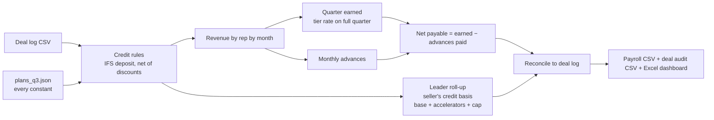

# Commission Engine

[](https://github.com/vrutikadani/commission-engine/actions/workflows/ci.yml)

A config-driven engine that calculates sales commissions for a full quarter: tiered rates, monthly advances, quarterly true-ups, financing-deal rules, leadership accelerators and revenue caps. Every payout traces back to a deal row and a plan rule.

> **About this repo.** I own quarterly commissions for a medical device + consumables sales org across capital sales, inside sales, account management and leadership plans. Payouts are calculated in a governed, formula-driven Excel model, and attainment visibility is moving to commission software. This repo is a separate Python reference engine. **All plans, names, quotas and deals are synthetic.**

## The business problem

- Comp plans changed every quarter: new roles, ramp quotas, new tier ladders, one-off exceptions.
- The old model had numbers typed into formulas, so one plan change meant hunting through hundreds of cells.
- Reps and leaders did not trust their numbers, and the CFO needed a clean audit trail before payroll.

## How it works



## Rules it handles

| Rule | How it works here |
|---|---|
| Tier ladders | Rate set by attainment. `retro` mode pays the reached rate on every dollar; `marginal` mode pays each slice its own rate |
| Tier basis ≠ quota | A plan can break tiers on a different basis than its quota |
| Ramp plans | Separate two-tier plan with no top tier |
| Monthly advances + true-up | Months are advanced as they close. Payroll gets three columns: `earned` (full quarter), `advances_paid` and `net_payable` = earned − advances paid. **A negative net payable is allowed** and labeled `RECOVER` |
| Financing (IFS) deals | Deposit ≥ $10K → full credit; $5K–$10K → flat $1.5K, no quota credit; below → $0 |
| Net revenue | Account-manager plans pay on revenue net of discounts, rebates and giveaways |
| Leadership plans | Team deals roll up on each seller's own credit basis (net for account managers, IFS rules for financing). Base paid in proportion to attainment from the first dollar, accelerators on revenue in 100–115 / 115–130 / 130–150% bands, capped at 150%, total capped at 10% of revenue |
| Speed bonus | Flat bonus per MQL closed quickly |
| Money | `decimal.Decimal` throughout. Rounded to the cent, half up, at three points: each monthly advance, the quarter commission, and each deal's share of it |
| Input checks | The run stops on a duplicate `deal_id`, an owner not in the roster, a month that is not `YYYY-MM`, a blank, missing or non-numeric amount, or an unknown deal type. Blank optional fields (discount, deposit) count as zero |
| Reconciliation | Every in-quarter deal is credited exactly once to its owner. A deal a director owns directly counts on the director's statement; the director's roll-up lines for team deals do not count again. Credited + excluded equals gross on every line. Each statement's lines sum to its earned pay. Leader credit per deal equals seller credit. The run fails if any check fails |
| Audit trail | Every deal (not only IFS) gets a line with its rule, credited amount, share of commission, flat pay and any fast-MQL bonus. Lines sum to earned pay to the cent |

**Design rule I hold to:** no plan constant is ever hard-coded. Quotas, breaks, rates, thresholds and the quarter's months all live in `config/plans_q3.json`. Rolling to a new quarter is a config change, not a code change.

## Limitations

- One quarter at a time. Clawbacks across quarters, deal splits and mid-quarter role changes are not modeled here.
- Retro rate mode is the default in the sample config. It creates a cliff at each tier break, which is a plan-design choice worth questioning, not a property of the engine.
- Input checks catch structural errors, not wrong facts. A real close date in the wrong month still pays in that month, so any real process should check numbers against a CRM attainment report before payroll.
- Flat IFS payments and bonuses are paid at quarter close, not advanced monthly.

## Run it

```bash
pip install openpyxl pytest
python data/make_synthetic.py   # regenerate synthetic deals (fixed seed)
python run_quarter.py           # quarter close -> output/
python -m pytest -q             # 50 tests
```

Sample output:

```
Rep           Role            Revenue  Attain   Rate    Earned  Advanced       Net
Avery Brooks  AE               160.0K     64%     5%      9.5K     13.3K     -3.8K  RECOVER
Riley Chen    AE               230.0K     92%    10%     23.0K     20.2K      2.8K
Drew Santos   ACCOUNT_MGR      221.0K    111%     8%     17.7K      0.0K     17.7K
Morgan Hale   DIRECTOR        1447.7K     90%      -     36.2K      0.0K     36.2K
```

The Excel dashboard shows figures in $K and uses live formulas so finance can audit it in Excel. The Total row counts each deal once (seller rows only) and does not sum quotas, since leader and rep quotas overlap. A **Deal Audit** tab lists every credited deal, and an **Audit Notes** tab explains every IFS decision, cap and recovery.

See [docs/INTERVIEW_WALKTHROUGH.md](docs/INTERVIEW_WALKTHROUGH.md) for a short code tour.

## Relationship to real work

This is a synthetic Python reference engine. It is not the commission process used at any employer. Real commission work is done in a governed spreadsheet and CRM process, with approvals; that process and its numbers are not public. The ideas this repo shows (config-driven plans, advances and true-ups, reconciliation, an audit line per deal) come from that kind of work.

