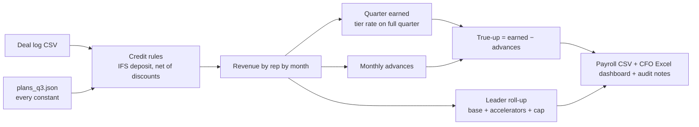

# Commission Engine

A config-driven engine that calculates sales commissions for a full quarter: tiered rates, monthly advances, quarterly true-ups, financing-deal rules, leadership accelerators and revenue caps. Every payout traces back to a deal row and a plan rule.

> **About this repo.** I own quarterly commissions for a medical device + consumables sales org, covering **$4M+ in revenue per quarter** across capital sales, inside sales, account management and leadership plans. I first ran it as a formula-driven Excel model, then moved it to automated commission software. This repo rebuilds the same logic in Python with **synthetic plans, reps and deals**. No real comp plans, names or figures are included.

## The business problem

- Comp plans changed every quarter: new roles, ramp quotas, new tier ladders, one-off exceptions.
- The old model had numbers typed into formulas, so one plan change meant hunting through hundreds of cells.
- Reps and leaders did not trust their numbers, and the CFO needed a clean audit trail before payroll.

## How it works



## Rules it handles

| Rule | How it works here |
|---|---|
| Tier ladders | Rate set by attainment. `retro` mode pays the reached rate on every dollar; `marginal` mode pays each slice its own rate |
| Tier basis ≠ quota | A plan can break tiers on a different basis than its quota (one real plan needed this) |
| Ramp plans | Separate two-tier plan with no top tier |
| Monthly advances + true-up | Months are advanced as they close; the quarter is settled as earned − advances. **Negative true-ups are allowed** and flagged as recoverable |
| Financing (IFS) deals | Deposit ≥ $8K → full credit; $3K–$8K → flat $2K, no quota credit; below → $0 |
| Net revenue | Account-manager plans pay on revenue net of discounts, rebates and giveaways |
| Leadership plans | Base paid in proportion to attainment from the first dollar, accelerators on revenue in 100–110 / 110–120 / 120–130% bands, capped at 130%, total capped at 17% of revenue |
| Speed bonus | Flat bonus per MQL closed quickly |

**Design rule I hold to:** no plan constant is ever hard-coded. Quotas, breaks, rates, thresholds and the quarter's months all live in `config/plans_q3.json`. Rolling to a new quarter is a config change, not a code change.

## Run it

```bash
pip install openpyxl pytest
python data/make_synthetic.py   # regenerate synthetic deals (fixed seed)
python run_quarter.py           # quarter close -> output/
python -m pytest -q             # 13 tests
```

Sample output:

```
Rep           Role            Revenue  Attain   Rate    Payout   True-up
Riley Chen    AE               247.5K    103%    12%     29.7K      6.7K
Taylor Reyes  INSIDE           149.2K     75%     7%     16.9K     -3.9K
Morgan Hale   DIRECTOR        1492.4K    115%      -     33.2K     33.2K
```

The Excel dashboard shows figures in $K, uses live `SUM` formulas so finance can audit it in Excel, and has an **Audit Notes** tab that explains every IFS decision, cap and negative true-up.

## Impact (production version)

- Covers **$4M+ in quarterly revenue** across every sales role.
- Plan changes went from cell-by-cell edits to one parameter block.
- Fed the move to fully automated commission software (CRM + ERP + commission platform), so reps now see attainment live.

---
Built by [Vrutik Adani](https://www.linkedin.com/in/vrutikadani) · GTM Systems & AI Engineering
